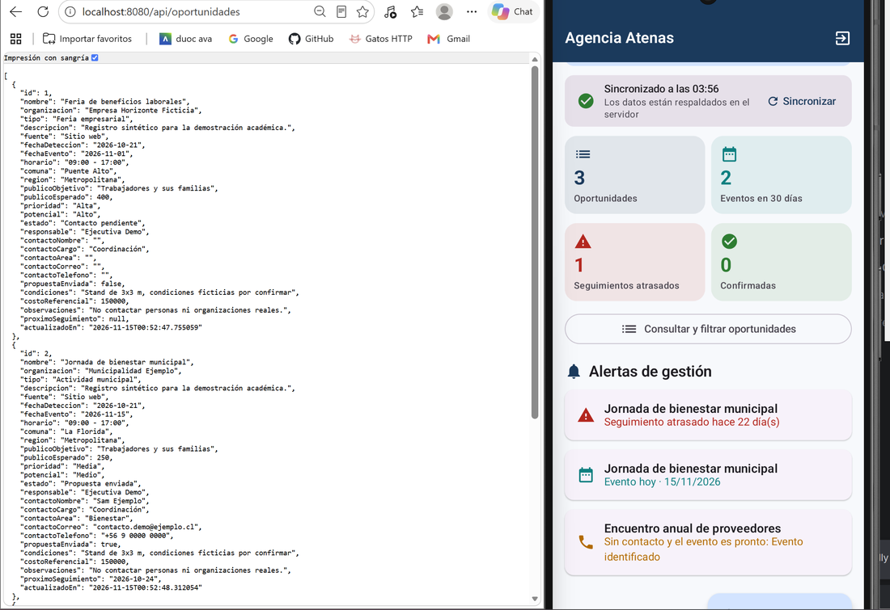
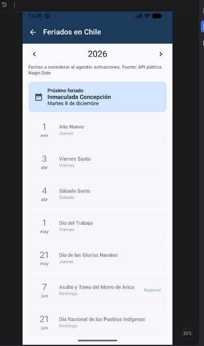
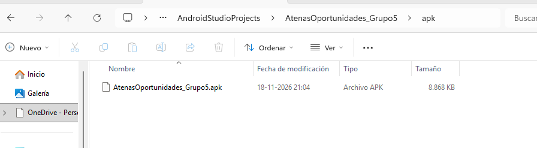
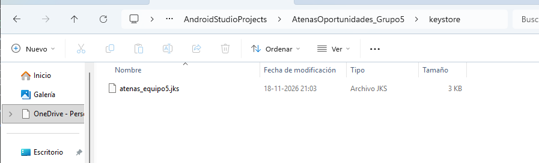
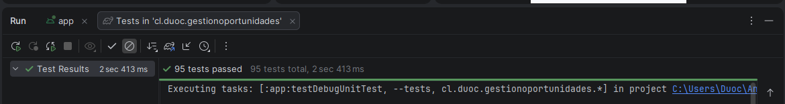
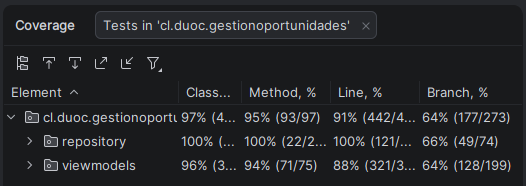
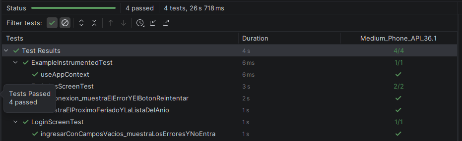

# Atenas Oportunidades

App Android para gestionar oportunidades y activaciones corporativas, con su propio microservicio REST y conexión a una API externa de feriados. La hicimos para **DSY1105 – Desarrollo de Aplicaciones Móviles** (Duoc UC), a partir del caso semestral de **Agencia Atenas**, una agencia de marketing directo que necesita encontrar a tiempo eventos corporativos, ferias y actividades municipales donde ofrecer sus convenios, y llevar el seguimiento de cada gestión en un solo lugar.

> Todos los datos de la app son **ficticios**. No usamos nombres, correos, teléfonos, RUT ni credenciales reales.

**Versión:** 4.0-EP4 · **Sección:** DSY1105-003D · **Equipo:** 5 · **Sede:** Puente Alto

## Integrantes
| Nombre | Rol en el proyecto |
|---|---|
| Natalie Gallegos Andulce | Desarrollo app móvil y microservicio |
| Pamela Cocq | Desarrollo app móvil y microservicio |

## El problema
Hoy el equipo comercial busca oportunidades a mano en redes sociales y sitios web, y la información termina repartida entre correos, mensajes y notas personales. Las oportunidades se detectan tarde y nadie sabe bien qué se contactó, qué propuesta se envió o qué gestión está atrasada. La app junta todo eso: registro, prioridad y seguimiento de cada oportunidad.

## Funcionalidades
- **Inicio de sesión** con cuentas ficticias, validación por campo y sesión que se mantiene al reabrir la app.
- **Panel de inicio** con indicadores animados (total, eventos próximos, seguimientos atrasados y confirmadas) y alertas de gestión.
- **Registro y edición de oportunidades** con todos los datos del caso: evento, organización, tipo, fuente, fechas, horario, comuna, región, público, prioridad, potencial, estado, responsable, contacto, condiciones, costo y observaciones.
- **Validación por campo** con ícono, mensaje específico y reglas de negocio (por ejemplo, rechaza el 31/02 y "Propuesta enviada" exige un contacto registrado).
- **Búsqueda y filtros** por texto, estado, prioridad, tipo, región y eventos próximos, con tres órdenes.
- **Ficha de la oportunidad** con cambio de estado, edición, eliminación con confirmación e historial de gestión.
- **Acciones de seguimiento** (los 12 tipos del caso) con próxima acción y fecha.
- **Persistencia local con SQLite**: dos tablas relacionadas (oportunidades y seguimientos), así que los datos no se pierden al cerrar la app.
- **Sincronización con nuestro microservicio** `atenas-api` (Spring Boot) usando Retrofit.
- **Feriados en Chile (API externa)**: pantalla que consulta la API pública Nager.Date, muestra el próximo feriado y la lista del año, y permite cambiar de año. Si no hay internet, avisa y ofrece reintentar. Sirve para planificar las activaciones evitando los feriados.
- **Recursos nativos**: ubicación (completa comuna y región), cámara (foto del afiche o stand) y notificaciones (recordatorio de seguimiento).

## Endpoints

### Microservicio propio: `atenas-api`
Spring Boot + JPA + H2. Corre en `http://localhost:8080`; desde el emulador se llega con `http://10.0.2.2:8080`.

| Método | Endpoint | Qué hace |
|---|---|---|
| GET | `/api/oportunidades` | Lista todas las oportunidades |
| GET | `/api/oportunidades/{id}` | Trae una oportunidad (404 si no existe) |
| POST | `/api/oportunidades` | Crea una oportunidad (400 con el detalle si hay datos inválidos) |
| PUT | `/api/oportunidades/{id}` | Actualiza una oportunidad |
| DELETE | `/api/oportunidades/{id}` | Elimina una oportunidad |

La app trabaja *offline first*: cada cambio se guarda primero en SQLite y después se sincroniza. Si el servidor está apagado, la app sigue funcionando, muestra "Sin conexión con el servidor" y manda los cambios pendientes en la siguiente sincronización.



### API externa: Nager.Date (feriados)
| Método | Endpoint | Qué hace |
|---|---|---|
| GET | `https://date.nager.at/api/v3/PublicHolidays/{anio}/CL` | Feriados de Chile para el año indicado |

Ejemplo: `https://date.nager.at/api/v3/PublicHolidays/2026/CL`. No necesita clave. De la respuesta usamos `date`, `localName` y `global` (si el feriado es nacional o regional).



| Archivo | Para qué está |
|---|---|
| `data/remote/OportunidadApiService.kt` | Endpoints del microservicio (Retrofit) |
| `data/remote/FeriadosApiService.kt` | Endpoint de la API de feriados (Retrofit) |
| `data/remote/RetrofitInstance.kt` | Las dos instancias de Retrofit (microservicio y Nager.Date) |
| `repository/OportunidadRepository.kt` | Une SQLite con el microservicio y maneja la sincronización |
| `repository/FeriadoRepository.kt` | Convierte la respuesta de feriados y calcula el próximo |
| `atenas-api/` | Código del microservicio (tiene su propio README) |

## Cómo ejecutar el proyecto

### 1. Levantar el microservicio (IntelliJ IDEA)
1. Abrir la carpeta `atenas-api` con **File → Open**.
2. Esperar a que Maven descargue las dependencias.
3. Ejecutar la clase `AtenasApiApplication` con el botón ▶.
4. Para comprobar que funciona, abrir en el navegador `http://localhost:8080/api/oportunidades`.

Si el servidor no está levantado, la app funciona igual, solo que no sincroniza.

### 2. Ejecutar la app (Android Studio)
1. Abrir la carpeta del proyecto (la que tiene `settings.gradle.kts`) con **File → Open**.
2. Esperar a que termine **Gradle Sync** (la primera vez necesita internet).
3. Elegir un emulador con API 26 o superior (recomendado API 33+).
4. Presionar **Run ▶**.
5. Entrar con una de estas cuentas ficticias:
   - `ejecutivo` / `Atenas2026`
   - `supervisor` / `Atenas2026`
6. Para ver la API externa: en el inicio, botón **Feriados en Chile (API externa)**. El emulador necesita internet.

La primera vez se cargan 3 oportunidades de ejemplo con fechas relativas a hoy, para que se vean las alertas.

### 3. Instalar el APK firmado
El APK ya generado está en `apk/AtenasOportunidades_Grupo5.apk`.
1. Si en el emulador está instalada la versión de desarrollo, desinstalarla primero (la firma es distinta y Android no deja reemplazarla).
2. Arrastrar el archivo `.apk` sobre la ventana del emulador, o en un teléfono abrirlo y aceptar "instalar apps de origen desconocido".

### Probar los recursos nativos en el emulador
- **Ubicación:** *Extended controls (···) → Location*, marcar un punto (por ejemplo, Puente Alto) y *Set location*. Luego en el formulario, "Completar comuna con mi ubicación".
- **Cámara:** el emulador muestra una escena virtual; se toma la foto y se confirma.
- **Notificaciones:** en una ficha, "Probar notificación (10 s)", aceptar el permiso y esperar.

## APK firmado y llave .jks
El APK de release se firma con nuestra propia llave:

| Dato | Valor |
|---|---|
| Archivo de la llave | `keystore/atenas_equipo5.jks` |
| Alias | `atenas_equipo5` |
| Titular del certificado | Natalie Gallegos, Equipo 5 DSY1105, Duoc UC, Puente Alto, CL |
| Validez | 25 años |
| APK generado | `apk/AtenasOportunidades_Grupo5.apk` |

La firma está configurada en `app/build.gradle.kts`, en el bloque `signingConfigs { create("release") { ... } }`, y el `buildType` release la usa con `signingConfig = signingConfigs.getByName("release")`.

**Para volver a generar el APK firmado:** en Android Studio, **Build → Generate Signed App Bundle or APK → APK**, elegir `keystore/atenas_equipo5.jks` con el alias `atenas_equipo5`, variante **release** y **Create**. El archivo queda en `app/release/`.





## Pruebas
| Tipo | Dónde | Cantidad | Resultado |
|---|---|---|---|
| Unitarias (JUnit 4 + MockK + coroutines-test) | `app/src/test/` | 95 | 95 pasan |
| De pantalla (Compose UI Test) | `app/src/androidTest/` | 4 | 4 pasan |
| Del microservicio (JUnit 5 + MockMvc) | `atenas-api/src/test/` | 6 | 6 pasan |

**Cobertura de la lógica:** 91 % de líneas en total (repository 100 %, viewmodels 88 %).

Qué se prueba:
- **Repositorios:** `OportunidadRepository` (guardar, editar, eliminar, sincronizar, qué pasa cuando el servidor falla), `AuthRepository` (login correcto e incorrecto, sesión) y `FeriadoRepository` (conversión de la respuesta, fechas inválidas, próximo feriado). La API y la base de datos se simulan con **MockK**.
- **ViewModels:** los 8 ViewModels, con sus estados de carga, error y éxito.
- **Validaciones:** reglas de los formularios (campos vacíos, fechas imposibles, correo, teléfono, horario, reglas de estado).
- **Pantallas:** el login muestra los errores cuando los campos están vacíos, y la pantalla de feriados muestra la lista y el próximo feriado, o el mensaje de error con el botón "Reintentar" cuando no hay conexión.

**Cómo ejecutarlas en Android Studio:**
- Unitarias: clic derecho en la carpeta `app/src/test/java` → **Run 'Tests in…'**.
- Cobertura: clic derecho en la misma carpeta → **Run 'Tests in…' with Coverage**.
- De pantalla: con el emulador encendido, clic derecho en `app/src/androidTest/java` → **Run 'Tests in…'**.







## Arquitectura (MVVM)
```
UI (Jetpack Compose + Material 3)
   │  eventos ↓            ↑ StateFlow
ViewModel (uno por pantalla)  ──→  validacion/
   │
Repository
   │                         │                              │
SQLite (local)        Retrofit → atenas-api          Retrofit → Nager.Date
```

```
app/src/main/java/cl/duoc/gestionoportunidades/
├── MainActivity.kt
├── navigation/      Screen, NavigationEvent, AppNavigation
├── viewmodels/      Main, Login, Inicio, Lista, OportunidadForm, Detalle, SeguimientoForm, Feriados
├── ui/
│   ├── screens/     Login, Inicio, Lista, OportunidadForm, Detalle, SeguimientoForm, Feriados
│   ├── components/  Campos con validación, etiquetas de estado, indicadores
│   └── theme/       Tema Material 3
├── repository/      OportunidadRepository, AuthRepository, FeriadoRepository, EstadoSync
├── data/
│   ├── local/       AtenasDbHelper, OportunidadDao, SeguimientoDao, SesionManager
│   ├── model/       Oportunidad, Seguimiento, Usuario, Feriado, Catalogos, Fechas
│   └── remote/      Servicios Retrofit, DTOs y mapeo
├── di/              AppContainer
├── validacion/      ValidadorLogin, ValidadorOportunidad, ValidadorSeguimiento
└── nativo/          UbicacionHelper, FotoHelper, Recordatorios, RecordatorioReceiver
```

Las pantallas no navegan solas: le piden la navegación a `MainViewModel`, que emite un `NavigationEvent`, y `AppNavigation` lo ejecuta. Los ViewModels reciben sus repositorios por constructor, por eso se pueden probar con MockK sin levantar Android.

## Tecnologías
**App:** Kotlin · Jetpack Compose · Material 3 · Navigation Compose · ViewModel + StateFlow · Corrutinas · SQLite · Retrofit 2 + Gson + OkHttp · AlarmManager · LocationManager · JUnit 4 · MockK · Compose UI Test
**Microservicio:** Java 17 · Spring Boot 3 · Spring Data JPA · H2 · JUnit 5 + MockMvc

## Planificación
Tablero Trello: https://trello.com/b/wLAJs7FL/atenas-oportunidades-ep2-dsy1105
